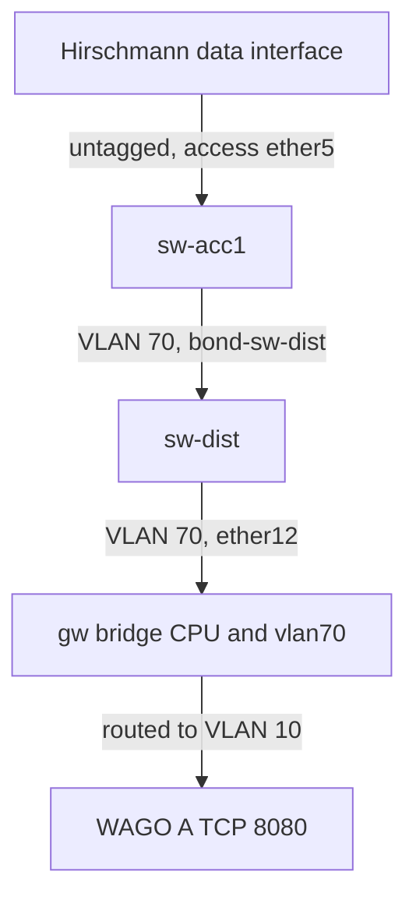

# Complete VLAN build: feasibility and acceptance

**Classification:** Course design is reversible. Applying it changes shared switch, gateway and endpoint state and requires an operator-approved isolated lab.

**Problem:** Creating a VLAN ID alone does not establish an end-to-end path or isolate traffic.
**Desired outcome:** A student can build one new subnet, prove an allowed application flow and a denied new connection, and restore the starting state.

**Options:**

- **A: Move the idle Hirschmann endpoint in an isolated copy.** Impact 9 (covers access, trunks, CPU, routing and policy). Confidence 8 (attachment, routes and gateway rules inspected; configuration trial remains pending). Ease 6 (three RouterOS devices and one host). **ICE = 432.**
- **B: Renumber an active WAGO PLC on the shared appliance.** Impact 8 (same networking concepts). Confidence 5 (application dependencies and other students could be interrupted). Ease 3 (requires application migration and shared-state coordination). **ICE = 120.**
- **C: Add only a VLAN table entry.** Impact 2 (does not demonstrate routed application traffic). Confidence 9 (the inspected gateway needs CPU membership and an L3 interface). Ease 9 (small change). **ICE = 162.**

**Recommendation: A.** Exercise 7 includes the build-sheet challenge now. A configuration version should be enabled only with a disposable lab per student or an explicitly reserved group appliance.

## Inspected path

The endpoint currently uses `10.50.0.12/8` on `eth1`; management is independent on `eth0`. Its name may stay `hirschmann-edge1-vlan50`. Use VLAN 70 with `172.22.70.12/24` and gateway `172.22.70.1/24`; both were unused in the inspected configuration. Avoid `10.70.0.0/24`: existing OT `/8` hosts would ARP for return destinations instead of routing them.

## Build order for the isolated version

1. Reserve the appliance, stop exercise captures and record original endpoint routes, addresses, bridge ports, VLAN membership, gateway interfaces and rule order. Verify independent management access to all four devices. Export configuration without secrets into private operator storage.
2. Prepare gateway input and forward policy before attaching the client. Preserve established/related replies. Allow client → WAGO A TCP 8080 and only the gateway diagnostics required for the lesson. Deny unapproved new initiations from/to the new interface before broad accepts. The existing `mgmt` list includes `172.16.0.0/12`; several broad rules may match, so inspect both chains rather than inserting below a guessed row number.
3. On gw, add VLAN 70 tagged membership for `ether12` and `bridge`, create its VLAN interface on `bridge`, and assign `172.22.70.1/24`. Preserve all existing VLAN 10 members.
4. On sw-dist, add VLAN 70 tagged membership for `bond-sw-acc1` and `ether12`. On sw-acc1, carry it tagged on `bond-sw-dist`, remove `ether5` from the old untagged VLAN and assign it PVID 70 with untagged VLAN 70 membership. Keep the two bond members inside their bond.
5. Replace the endpoint data address and gateway. Replace its explicit routes for `1.0.0.0/8` and `2.2.2.0/24` that still name the old gateway, as well as its default. Preserve management and unrelated multicast routes.

## Acceptance and restoration

- Endpoint route selection: WAGO A through `172.22.70.1`; management remains directly reachable through `eth0`.
- Ping the new gateway. If it fails, check access membership/PVID, each tagged hop, bridge CPU membership, interface/address and input policy in that order.
- Access capture is untagged; at least one bond member and the gateway uplink show VLAN 70. An individual hashed flow need not appear on both bond members.
- A new HTTP request to WAGO A `10.10.0.11:8080/webvisu.htm` returns 200. Its existing return route for `172.22.70.12` uses `10.10.0.1`.
- A fresh client connection to WAGO A TCP 22 is denied by the intended rule, although the server was proved open before the change. Record rule/log evidence; a timeout alone cannot distinguish firewall denial from a broken path.
- A fresh reverse initiation is denied while replies to the permitted HTTP exchange succeed. Verify normal OT application traffic and independent management throughout.
- Restore endpoint data addressing/routes and access membership coherently, then remove the new trunk membership, gateway address/interface and only the rules created for this exercise. Compare the saved starting values and repeat the original connectivity checks.

Using the DMZ jumphost as the allowed server would additionally require a return route for `172.22.70.0/24` via `2.2.2.1`; its default uses management. WAGO A avoids that extra dependency.

No VLAN configuration, forwarding policy or physical link was changed during this review. The deployed app supports the terminals and captures needed for a manual build; it does not provision an isolated VLAN lab from an exercise. That isolation/reset capability is the remaining prerequisite for a repeatable student configuration challenge.

References: [MikroTik bridge VLAN table](https://help.mikrotik.com/docs/spaces/ROS/pages/28606465/Bridge+VLAN+Table), [RouterOS filter chains](https://manual.mikrotik.com/docs/firewall-and-quality-of-service/firewall/filter/), [NIST SP 800-82r3](https://csrc.nist.gov/pubs/sp/800/82/r3/final).
