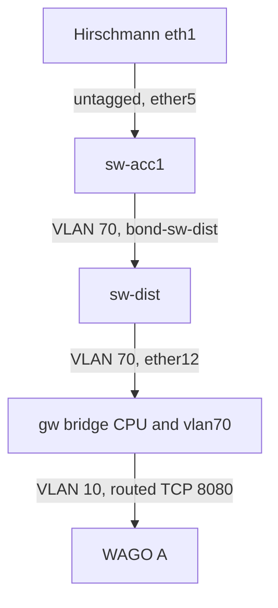

# Complete VLAN build: decision and qualified implementation

**Classification:** Course edits are reversible. The configuration trial uses the operator-approved isolated VM223 copy; the shared VM222 network stays flat.

**Problem:** Adding a VLAN ID alone does not create an end-to-end path or enforce a boundary.
**Desired outcome:** Students build a subnet, prove allowed application traffic and denied new connections, and restore the recorded starting state.

**Options:**

- **A: Move the Hirschmann endpoint in a reserved copy.** Impact 9 (covers access, trunks, CPU, routing and policy). Confidence 9 (the build, both extras, manual cleanup and checkpoint restore passed on the isolated copy). Ease 6 (three RouterOS devices and one Linux endpoint). **ICE = 486.**
- **B: Renumber an active WAGO PLC on the shared appliance.** Impact 8 (covers the networking concepts). Confidence 5 (application dependencies and concurrent students create uncertainty). Ease 3 (application migration and shared-state coordination). **ICE = 120.**
- **C: Add only a VLAN table entry.** Impact 2 (does not demonstrate routed application traffic). Confidence 9 (the inspected gateway requires CPU membership and an L3 interface). Ease 9 (small change). **ICE = 162.**

**Recommendation: A.** Exercise 7 now contains the complete practical, with an instructor preparation/reset guide. It requires a reserved disposable appliance; the reader does not provision or reset one.

## Qualified path

VLAN 70 uses `172.30.70.0/24`, Hirschmann `172.30.70.12` and gateway `172.30.70.1`. The trial rejected the earlier `172.22.70.0/24` proposal because Docker already owns an overlapping `/16`. A `10.70.0.0/24` choice would overlap the flat OT `/8` return paths. Stable node names remain unchanged.

The lesson prepares scoped input/forward rules ahead of broad private-source accepts, while retaining earlier established/related handling. It adds tagged membership through both switches and the gateway CPU, moves only Hirschmann's data address/routes, and proves HTTP 200 while fresh forward/reverse SSH and gateway SSH are filtered by the intended rules. It adds the replacement Linux address before removing the old one so unrelated multicast routes survive.

The two extras follow one unchanged HTTP payload across VLAN 70/10 and distinguish stateful replies from new reverse connections. Mandatory cleanup returns the full configuration and endpoint routes to the original flat state. An actual private checkpoint restore was also exercised.

See [the practical validation](2026-10-18-vlan-practical.md) for results and specific app limitations. Instructor instructions are in the [English](../docs/en/lab-practical.md) and [German](../docs/de/lab-practical.md) guides.

References: [MikroTik bridge VLAN table](https://help.mikrotik.com/docs/spaces/ROS/pages/28606465/Bridge+VLAN+Table), [RouterOS filter chains](https://manual.mikrotik.com/docs/firewall-and-quality-of-service/firewall/filter/), [connection tracking](https://manual.mikrotik.com/docs/firewall-and-quality-of-service/connection-tracking/), [NIST SP 800-82r3](https://csrc.nist.gov/pubs/sp/800/82/r3/final).
