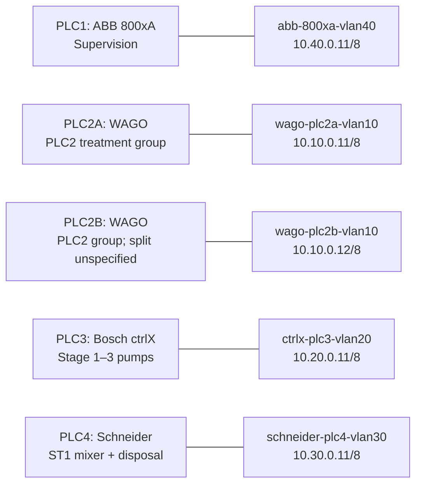
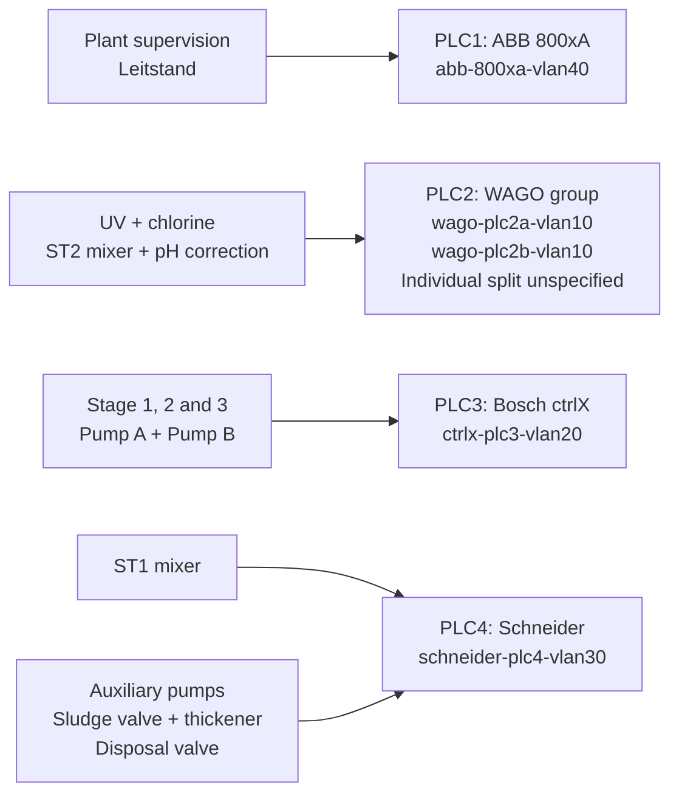
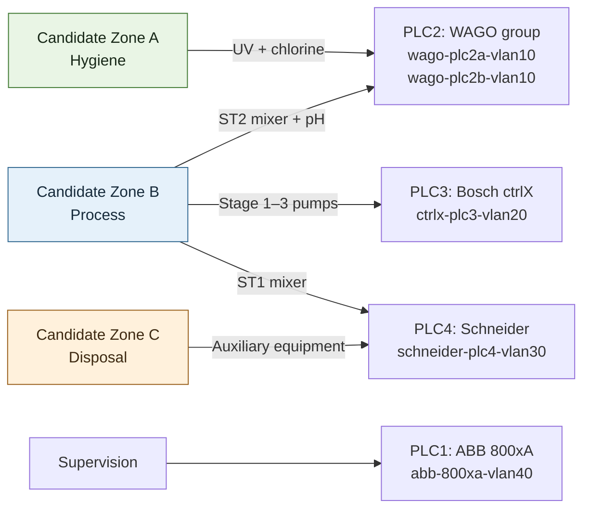

# PLC names, lab hostnames and visual options

Draft reference for the beginning of the student exercises. The controller allocation comes from PDF page 34 and its repetition on PDF page 131 (printed slide 140) of the supplied course handout. Hostnames and data addresses come from `labs/ot-student/ot-sec-flat.clab.yml` in `nwos-build`.

## Controller mapping

| Slide name | Lab hostname | Baseline data address | Course responsibility |
| --- | --- | --- | --- |
| ABB 800xA PLC1 | `abb-800xa-vlan40` | `10.40.0.11/8` | Supervisory system / Leitstand |
| WAGO PLC2A | `wago-plc2a-vlan10` | `10.10.0.11/8` | PLC2 treatment functions; see the shared allocation below |
| WAGO PLC2B | `wago-plc2b-vlan10` | `10.10.0.12/8` | Second PLC2 host; the handout does not assign separate outputs to 2A and 2B |
| Bosch ctrlX PLC3 | `ctrlx-plc3-vlan20` | `10.20.0.11/8` | Stage 1–3 pumps |
| Schneider PLC4 | `schneider-plc4-vlan30` | `10.30.0.11/8` | Stage 1 mixer and auxiliary/disposal equipment |

All five data interfaces start in **VLAN 10**, using the flat `/8` lab subnet. The hostname suffixes do not indicate enforced VLAN separation in this baseline.

The handwritten disposal label “SPS1” in the supplied discrepancy sketch must not be confused with ABB PLC1. In the detailed controller allocation, disposal belongs to **Schneider PLC4**, which also owns the ST1 mixer. Use that explicit name in the new figure.

The handout groups the four WAGO functions under **PLC2** without dividing them between **2A and 2B** or establishing an active/standby arrangement. Preserve that group in the figures. The checked-in 2A visualization starts at `wago_plc2ab_HMI`; the 2B bundle starts at `Leitstand`. Neither a hostname nor an application symbol list proves that two running PLCs implement qualified redundancy.

## Process-to-controller mapping

The screenshot uses `Mixer` where the controller allocation says `Rührwerk`. These are corresponding labels for the depicted mixing function, not additional controllers.

| Process label in the supplied diagrams | Controller allocation | Hostname reference |
| --- | --- | --- |
| `ST2_UV` | WAGO PLC2 group | `wago-plc2a-vlan10` / `wago-plc2b-vlan10`; individual allocation unspecified |
| `ST2_Chlor` | WAGO PLC2 group | Same PLC2 group |
| `ST2_Mixer` / `ST2_Rührwerk` | WAGO PLC2 group | Same PLC2 group |
| `ST2_PH_Ausgleich` | WAGO PLC2 group | Same PLC2 group |
| `ST1_PumpeA` | Bosch ctrlX PLC3 | `ctrlx-plc3-vlan20` |
| `ST1_PumpeB` | Bosch ctrlX PLC3 | `ctrlx-plc3-vlan20` |
| `ST2_PumpeA` | Bosch ctrlX PLC3 | `ctrlx-plc3-vlan20` |
| `ST2_PumpeB` | Bosch ctrlX PLC3 | `ctrlx-plc3-vlan20` |
| `ST3_PumpeA` | Bosch ctrlX PLC3 | `ctrlx-plc3-vlan20` |
| `ST3_PumpeB` | Bosch ctrlX PLC3 | `ctrlx-plc3-vlan20` |
| `ST1_Mixer` / `ST1_Rührwerk` | Schneider PLC4 | `schneider-plc4-vlan30` |
| `Aux_PumpeA` | Schneider PLC4 | `schneider-plc4-vlan30` |
| `Aux_PumpeB` | Schneider PLC4 | `schneider-plc4-vlan30` |
| `Aux_Schlamventil` | Schneider PLC4 | `schneider-plc4-vlan30` |
| `Aux_Deponieventil` | Schneider PLC4 | `schneider-plc4-vlan30` |
| `Aux_Schlamverdicker` | Schneider PLC4 | `schneider-plc4-vlan30` |

These are teaching allocations from the handout, not measurements of live I/O ownership or a list of verified network flows. Tanks, filters and the water-flow arrows in the drawing do not each imply another PLC or hostname.

## Related lab roles

| Role | Lab hostname / displayed name | Data address |
| --- | --- | --- |
| HMI browser | `pilz-hmi01-vlan40` | `10.40.0.12/8` |
| Engineering workstation | `dell-ews1-vlan50` | `10.50.0.11/8` |
| Other cell/test computer | `hirschmann-edge1-vlan50` | `10.50.0.12/8` |
| DMZ jumphost | `proxmox-jumphost` | `2.2.2.2/24` |
| Simulated external computer | `panasonic-toughbook-internet` | `1.1.1.1/24` |
| Routed diode | Runtime node `diode-agent`; displayed as `vlan10-diode` | WAN `10.10.0.21/8`; LAN `192.168.254.254/24` |
| Protected legacy-computer stand-in | `protected-linux` | `192.168.254.1/24` |

The diode and Protected Linux are the addon boundary, not replacements for Schneider PLC4 or another PLC in the process allocation.

## Option 1: Controller lookup

One line per PLC: slide name, exact searchable hostname and data address. Lines mean “maps to”, not network cables or control flows. This is the simplest opening reference.

## Option 2: Start with the plant function

Students find a familiar process function, then follow its allocation to a lab hostname. The paired WAGO hosts remain one PLC2 group; the diagram does not assign duplicated control or failover behavior.

Arrows show process responsibility, not measured communication, physical pipes or packet direction.

## Option 3: Show why the zone sketch is difficult

Compare the proposed zones with the controller allocation. WAGO spans hygiene and process functions. Schneider spans process and disposal functions. A single PLC data interface cannot place that PLC's different outputs into independently enforced VLANs.

These are candidate functional zones, not the current network configuration. All five PLC data interfaces still start in VLAN 10. Arrows show controller allocation; they are not conduits or evidence of inter-zone traffic. The WAGO 2A/2B split remains unspecified.

## Recommendation for the exercise introduction

**Reversibility:** Two-way door; documentation and proposed diagrams only.

**Problem:** Students see process labels, PLC numbers and long hostnames without a clear cross-reference.

**Desired outcome:** Students can select the correct lab endpoint before learning networking concepts, while retaining the controller boundaries needed later for segmentation.

**Options:**

- Option 1. Impact 9: directly supports finding the correct endpoint in every lesson. Confidence 9: all five hostname/address pairs were checked against the lab topology and the slide allocation was read. Ease 9: one short reference without introducing zone planning. **ICE 729.**
- Option 2. Impact 8: connects familiar process functions to the lab endpoints. Confidence 8: the handout supplies the function groups, but does not divide PLC2 between 2A and 2B. Ease 7: requires a larger figure and a responsibility-arrow explanation. **ICE 448.**
- Option 3. Impact 9: exposes the controller overlap that matters in Exercise 7. Confidence 8: the controller allocation is explicit; the zones are the handout's proposed design, not deployed enforcement. Ease 6: requires students to understand the difference between a functional zone and an Ethernet boundary. **ICE 432.**

**Recommendation:** Option 1 for the beginning of the exercises. Use the explicit mapping above as its text equivalent. Option 3 is a useful later discussion figure for Exercise 7.

## Evidence and limits

The supplied handout's allocation pages and the two attached zone/discrepancy images were compared. The images use `Mixer`; the allocation table uses `Rührwerk`. No outputs were reassigned and no runtime, VLAN or diode policy was changed. The mappings describe the checked-in student-lab configuration and the course's intended process roles; they do not qualify live control behavior or a PLC2 redundancy arrangement.

No configured Mermaid rendering tool or preinstalled Mermaid CLI was available in this session. The three diagrams use ordinary Mermaid flowchart syntax and are editable proposals; no dependency was installed. They have not been embedded in the exercise reader or exported as SVG/PNG.
